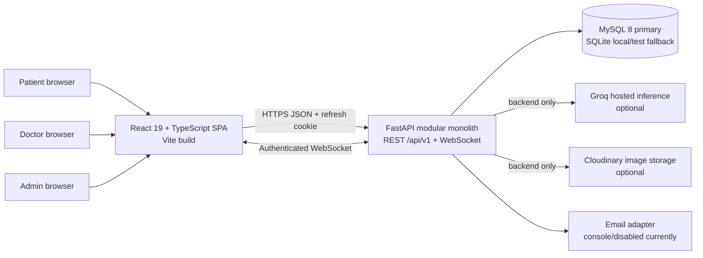
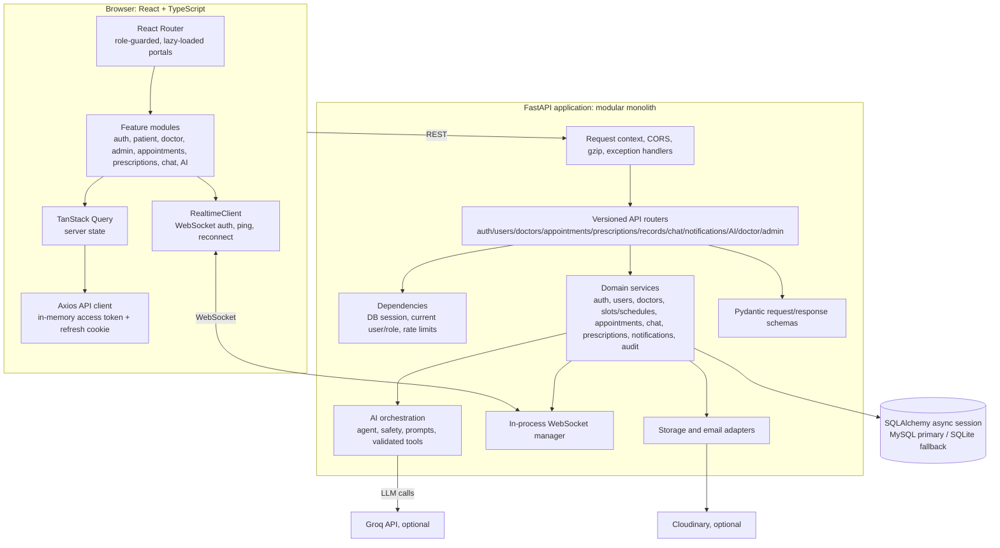

# EGS Health

Hospital appointment and care-coordination platform: patients book doctors, chat with them and use an
AI symptom assistant; doctors manage their day; admins manage doctors, schedules and the clinic.

* **Frontend**: React 19 + TypeScript (Vite), React Router, TanStack Query
* **Backend**: FastAPI (modular monolith), SQLAlchemy 2 (async), Alembic, **MySQL 8** (aiomysql driver)
* **Integrations**: Cloudinary (images), Groq (AI assistant, tool calling), WebSockets (realtime chat)
* No Docker required.

Design, data model, security and compliance notes: **[docs/ARCHITECTURE.md](docs/ARCHITECTURE.md)**.

## Features

| Patient | Doctor | Admin |
|---|---|---|
| Self-registration, profile, photo | Today / upcoming / past appointments | Create, edit, (de)activate, remove doctors |
| Search doctors by name/specialization | Confirm, complete, no-show, cancel | Specializations |
| Live 30-min slot availability, booking | Patient list and details (own patients only) | Weekly schedules with multiple shifts |
| Upcoming / past appointments, cancellation | Chat with patients (text + images) | Leave, unavailability, clinic holidays |
| Chat with doctors (text + images) | Read-only schedule view | Appointments overview, users, audit log |
| AI symptom assistant with doctor suggestions | Notifications | Dashboard counters |
| Digital e-prescriptions, active medication tracker & printable PDF | Issue & manage structured e-prescriptions with medicines & dosages | Audit log |

Cross-cutting: RBAC enforced in the API, database-level double-booking protection, appointment state
machine, realtime chat with reconnection, in-app/realtime/email notifications, reminders, audit
logging, rate limiting, structured logs with request IDs.

## Prerequisites

* Python 3.12+ and Node.js 20.19+ (22 LTS recommended)
* MySQL 8.0+ (InnoDB, utf8mb4). SQLite works as a zero-setup fallback for a quick try-out
* Optional: a Cloudinary account (image uploads) and a Groq API key (AI assistant)

## Run Configuration & Quick Start

### Option 1: One-Click Windows Runners (Recommended)

1. **Backend**: Double-click or run [`run_backend.bat`](file:///d:/Extra%20Project/EGS_Haspital/run_backend.bat)
   - Automatically sets up Python virtual environment (`.venv`)
   - Installs `requirements.txt`
   - Automatically creates the MySQL database `onezae` if it does not exist
   - Runs `alembic upgrade head`
   - Seeds default **Admin**, **Doctor**, and **Patient** accounts
   - Launches FastAPI at `http://127.0.0.1:8000`

2. **Frontend**: Double-click or run [`run_frontend.bat`](file:///d:/Extra%20Project/EGS_Haspital/run_frontend.bat)
   - Installs frontend packages (`npm install`)
   - Starts the Vite development server at `http://localhost:5173`

3. **Re-seed Users**: Double-click or run [`seed_users.bat`](file:///d:/Extra%20Project/EGS_Haspital/seed_users.bat)

---

### Option 2: Manual Terminal Commands (Windows PowerShell / CMD)

#### Step 1: Database Setup & Alembic Fix
If you get `OperationalError: (1049, "Unknown database 'onezae'")` when running Alembic, it means MySQL has not created the database yet. You can auto-create it with our script:

```bash
cd backend
.venv\Scripts\activate
python -m scripts.init_db
```

Or run this SQL in your MySQL Command Line / Workbench:
```sql
CREATE DATABASE IF NOT EXISTS onezae CHARACTER SET utf8mb4 COLLATE utf8mb4_unicode_ci;
```

*(Zero-setup alternative: Change `DATABASE_URL` in `backend/.env` to `DATABASE_URL=sqlite+aiosqlite:///./app.db`)*

#### Step 2: Backend Setup & Run
```bash
cd backend

# 1. Create and activate virtual environment
python -m venv .venv
.venv\Scripts\activate      # Linux/macOS: source .venv/bin/activate

# 2. Install dependencies
pip install -r requirements.txt

# 3. Ensure database exists and run migrations
python -m scripts.init_db
alembic upgrade head

# 4. Seed default users (Admin, Doctor, Patient)
python -m scripts.seed_defaults

# 5. Start API server
uvicorn app.main:app --reload --host 127.0.0.1 --port 8000
```

#### Step 3: Frontend Run
```bash
cd frontend
npm install
npm run dev                 # http://localhost:5173
```

---

### Option 3: VS Code Run Configurations
VS Code / Cursor debug configurations are included in [`.vscode/launch.json`](file:///d:/Extra%20Project/EGS_Haspital/.vscode/launch.json). Press `F5` or select from the Run & Debug menu:
* **Backend: FastAPI (Uvicorn)** — Runs the API with live-reload
* **Backend: Initialize Database** — Ensures MySQL database exists
* **Backend: Alembic Upgrade Head** — Applies migrations
* **Backend: Seed Default Users** — Seeds Admin, Doctor, and Patient

---

## Default Login Credentials

| Role | Portal | Email | Password |
|---|---|---|---|
| **Admin** | Staff Portal | `admin@hospital.com` | `AdminPassword123` |
| **Doctor** | Staff Portal | `doctor@hospital.com` | `DoctorPassword123` |
| **Patient** | Patient Portal | `patient@hospital.com` | `PatientPassword123` |

* **Web Application**: http://localhost:5173
* **Interactive API Docs (Swagger UI)**: http://127.0.0.1:8000/docs


## Configuration

All settings are environment variables (or `backend/.env`); see `backend/.env.example` for the
full list with comments. The most important:

| Variable | Purpose |
|---|---|
| `SECRET_KEY` | JWT signing key (≥32 random chars in production) |
| `DATABASE_URL` | `mysql+aiomysql://onezae:<password>@127.0.0.1:3306/onezae?charset=utf8mb4` |
| `CLINIC_TIMEZONE` | IANA zone for schedules and display (default `Asia/Kolkata`) |
| `APPOINTMENT_DURATION_MINUTES` | Slot length (default 30) |
| `CANCELLATION_CUTOFF_HOURS`, `BOOKING_WINDOW_DAYS`, `BOOKING_MIN_LEAD_MINUTES` | Booking policy |
| `CLOUDINARY_CLOUD_NAME`, `CLOUDINARY_API_KEY`, `CLOUDINARY_API_SECRET` | Image uploads (server-side only) |
| `GROQ_API_KEY`, `GROQ_MODEL` | AI assistant (server-side only) |
| `RATE_LIMIT_AUTH`, `RATE_LIMIT_AI`, `RATE_LIMIT_UPLOAD` | `requests/seconds` |
| `EMERGENCY_PHONE_NUMBER` | Shown in emergency guidance (default `112`) |

Secrets never reach the browser: the frontend only uses `VITE_*` variables (`frontend/.env.example`)
and the public `GET /api/v1/meta` endpoint.

### Enabling the AI assistant

Add your Groq key to `backend/.env` (the same provider and model as the INSURANCE-RAG backend):

```env
GROQ_API_KEY=gsk_...
GROQ_MODEL=openai/gpt-oss-120b
```

Restart the API, then evaluate live behaviour on the demo data:

```bash
python -m scripts.ai_eval
```

Without a key, general symptom analysis returns `503 ai_unavailable` except for emergency
symptoms, which still receive emergency-care guidance. Doctor-directory and appointment requests
use live hospital data and remain available without the model provider; patients can select and
book an offered slot directly in the consultation. If a configured provider is temporarily
unreachable, the assistant returns a safe fallback reply.

### Enabling image uploads

Set the three `CLOUDINARY_*` variables. Chat images are stored as authenticated assets (signed URLs);
profile images are public. Without credentials, upload endpoints return `503 uploads_not_configured`.

## Quality checks

| | Backend (`backend/`) | Frontend (`frontend/`) |
|---|---|---|
| Lint | `ruff check .` | `npm run lint` |
| Format | `ruff format .` | `npm run format` |
| Types | `mypy app scripts` | `npm run typecheck` |
| Tests | `pytest` | `npm test` |
| Build | — | `npm run build` |

By default tests use a throw-away SQLite file per test. Run them against MySQL (recommended
before deploying; includes the concurrent-booking tests) with a dedicated empty database:

```bash
TEST_DATABASE_URL="mysql+aiomysql://onezae:<password>@127.0.0.1:3306/onezae_test?charset=utf8mb4" pytest
```

## Database migrations

```bash
alembic revision --autogenerate -m "describe change"   # after changing app/models
alembic upgrade head
alembic downgrade -1
```

Every schema change needs a migration; review autogenerated files before committing.

## Production deployment (Linux, no Docker)

nginx serves the built SPA and proxies `/api/` (REST and the `/api/v1/ws` WebSocket) to gunicorn on
`127.0.0.1:8000`.

1. **MySQL 8**: create the database and user (see `backend/.env.example`), use InnoDB with
   `utf8mb4`; enable encrypted backups (daily `mysqldump --single-transaction` or binary-log based
   point-in-time recovery) and test restores.
2. **Backend** in `/srv/onezae/backend`:
   ```bash
   python3 -m venv .venv && .venv/bin/pip install -r requirements.txt
   cp .env.example .env   # edit: ENVIRONMENT=production, SECRET_KEY, DATABASE_URL, COOKIE_SECURE=true,
                          # CORS_ORIGINS=https://app.example.com, ALLOWED_HOSTS=app.example.com,
                          # LOG_JSON=true, FRONTEND_URL, Cloudinary, Groq
   .venv/bin/python -m scripts.seed
   .venv/bin/python -m scripts.create_admin you@hospital.org "First" "Last"
   ```
   Startup fails fast if production settings are unsafe (default secret, DEBUG, insecure cookies,
   wildcard CORS).
3. **Run the API**: apply migrations with `alembic upgrade head` on each release, then run
   `gunicorn app.main:app -c gunicorn.conf.py` under a process manager of your choice. Realtime
   pushes are per worker process: use `WEB_CONCURRENCY=1`, or add a Redis broker, see
   `gunicorn.conf.py`. Schedule `python -m scripts.send_reminders` every 5–15 minutes (cron or similar).
4. **Frontend**: `npm ci && npm run build`, publish `frontend/dist/` to `/srv/onezae/frontend/dist`.
5. **Reverse proxy** (e.g. nginx) with TLS: serve `frontend/dist` with an SPA fallback to `index.html`,
   proxy `/api/` to `127.0.0.1:8000`, and forward WebSocket upgrade headers for `/api/v1/ws`.

**Windows server**: gunicorn doesn't run on Windows; use
`uvicorn app.main:app --host 127.0.0.1 --port 8000 --proxy-headers` under a service manager (NSSM)
behind IIS or nginx.

# Complete Architecture Reference

The following sections consolidate the high-level, intermediate, and deep architecture references into this root README, including diagram-generation prompts.

---

# EGS — High-Level Architecture

## Purpose

EGS is a web based hospital appointment and care coordination application. Patients find doctors, book visits, chat, review records and prescriptions, and use an informational symptom assistant. Doctors manage appointments, patient communication, and prescriptions. Administrators manage clinic staff, schedules, users, and operations.

## System context



## Main capabilities

- Role based portals for patients, doctors, and administrators.
- Doctor directory, specializations, schedules, availability, and appointment booking.
- Appointment lifecycle, reminders, and notifications.
- Patient/doctor messaging with optional image attachments and realtime presence/events.
- Structured prescriptions and patient record views.
- AI symptom guidance with optional doctor/availability lookup through application tools.
- Administration, audit history, user management, and clinic time off/holidays.

## Technology and boundaries

| Area | Implementation |
|---|---|
| Web client | React 19, TypeScript, React Router, TanStack Query, Axios, Vite |
| Application server | Python 3.12+, FastAPI, Pydantic 2, SQLAlchemy 2 async |
| API | Versioned JSON REST API and authenticated WebSocket under `/api/v1` |
| Database | MySQL 8 / InnoDB is the intended production database; SQLite is supported for local development and tests |
| Schema evolution | Alembic migrations |
| Optional providers | Groq for AI inference; Cloudinary for images |

The backend is one deployable modular monolith. Its API routes, services, models, and integrations are modules in the same application, not independently deployed microservices. The backend owns authorization and domain rules; the browser is a client and is not an authorization boundary.

## Deployment shape

The documented production shape is a static frontend served by nginx or an equivalent reverse proxy, with `/api/` and WebSocket traffic proxied to a FastAPI/Gunicorn process and a MySQL database. This is deployment guidance in the repository, not evidence of a currently selected hosting provider. The realtime connection registry is in process; multi-worker delivery needs a shared broker (not currently implemented) or a single worker.

## Diagram-generation prompt

Copy this prompt into your diagramming AI:

> Create a clear, professional **high-level system context architecture diagram** for the EGS hospital appointment and care coordination web application. Show three human actors (Patient, Doctor, Admin) using one React 19 + TypeScript single-page web application built with Vite. Show the browser communicating with one FastAPI modular-monolith backend: JSON REST requests under `/api/v1` over HTTPS and a separate authenticated WebSocket connection for realtime events. Show backend persistence in MySQL 8 as the intended production database, with SQLite only as a local/test fallback. Show optional backend-only integrations to Groq for AI symptom guidance and Cloudinary for image storage. Show the email adapter as currently console/disabled, with no production email provider configured. Label the main capabilities: appointments and scheduling, doctor directory, chat and notifications, prescriptions and records, AI assistant, and admin operations/audit. Make clear that the backend enforces authorization and business rules. Use arrows to indicate direction, distinguish optional providers with dashed outlines, and do not invent cloud hosting, Redis, microservices, payment systems, or external clinical systems. Output the diagram plus a short legend. Mermaid or C4-style context notation is acceptable.

## Source of truth

This summary reflects the repository as inspected. For implementation layers and request flows see [README_INTERMEDIATE_LEVEL.md](README_INTERMEDIATE_LEVEL.md); for backend internals, data model and rules see [README_DEEP_LEVEL.md](README_DEEP_LEVEL.md). Existing design documentation is also in [ARCHITECTURE.md](ARCHITECTURE.md) and [PROJECT_OVERVIEW.md](PROJECT_OVERVIEW.md).

---

# EGS — Intermediate Architecture

This view explains the major code modules and how the browser, API, business services, database, and providers interact.

## Component view



## Frontend organization

- `frontend/src/app/` starts and configures the app and route tree. Routes are split by feature/page modules and guarded by sign-in and role checks.
- `frontend/src/features/` contains user journeys and API wrappers for auth, patient, doctor, admin, appointments, prescriptions, notifications, chat, and AI.
- `frontend/src/lib/api-client.ts` configures Axios, attaches the in-memory access token, sends cookies, refreshes on eligible 401 responses, and delegates unrecoverable sessions to auth state.
- `frontend/src/lib/realtime.ts` manages the WebSocket lifecycle, sends the access token in the first frame, pings, reconnects with backoff, and emits `reconnected` so views can refresh from REST.
- TanStack Query manages fetched server state. REST remains the source of truth after a realtime reconnect.

## Backend organization

- `backend/app/main.py`: FastAPI app, lifespan, middleware, exception registration, and API mount.
- `backend/app/api/v1/router.py` and `routes/`: endpoint groups. Dependencies in `app/api/deps.py` provide sessions, authenticated users, role requirements, and rate limits.
- `backend/app/schemas/`: validated request/response contracts.
- `backend/app/services/`: domain logic, persistence operations, ownership checks, and workflows.
- `backend/app/models/`: SQLAlchemy entities and enums.
- `backend/app/db/`: async engine, session factory, base model and timestamp handling.
- `backend/app/core/`: config, security, middleware, logging, errors, pagination, time helpers, and rate limiting.
- `backend/app/ai/`: model client, agent/graph, prompts, schemas, safety checks, and service tools.
- `backend/app/integrations/`: image storage and email abstractions.
- `backend/app/realtime/`: in-process connection registry used by WebSocket routes and notifications.
- `backend/alembic/` and `backend/scripts/`: migrations, initialization, seed data, reminders, and AI evaluation.

## Typical request paths

### Login and authenticated REST

1. The browser sends credentials to the auth route.
2. The backend authenticates against the user record and issues a short-lived access token plus a refresh token in an httpOnly cookie.
3. The frontend keeps the access token in memory and attaches it as a Bearer token. On an eligible 401 it uses the cookie to request a fresh access token and retries once.
4. API dependencies validate the current user and required role. Service functions enforce ownership and business policy before database changes.

### Appointment discovery and booking

1. The patient frontend requests doctors and availability through REST.
2. Doctor/schedule/slot services calculate bookable slots using clinic timezone, schedules, time off, existing appointments, and configured booking limits.
3. The patient submits a selected slot. The appointment service rechecks availability and persists the appointment.
4. A database unique index on active doctor and patient slots is the final concurrent double-booking guard. Appointment transitions can stage notifications and audit events.

### Chat and realtime updates

1. The client opens `/api/v1/ws` and sends its access token in an initial auth frame, not in the URL.
2. The server validates the token, registers the socket in an in-process connection manager, and delivers ready/presence/events.
3. REST routes persist messages and attachments metadata; notifications/events are pushed to connected recipients.
4. After a disconnect, the browser reconnects and retrieves missed messages through REST. The database is authoritative. Cross-process broadcast is not provided by the current manager.

### AI assistant

1. A patient sends a symptom message to `/api/v1/ai/...`; API dependencies enforce patient access and rate limits.
2. AI service applies input bounds and safety checks, builds model context, and invokes the optional Groq client.
3. The agent can invoke validated backend tools for doctor/specialization and availability lookup. Tools call application services rather than accessing the database directly.
4. Structured results and conversation messages are stored. Booking selected appointment options uses the regular appointment service, so booking rules still apply.
5. Emergency guidance and disclaimer safeguards are implemented in the backend. This feature is informational, not a diagnosis.

## Cross-cutting behavior

- Pydantic schemas validate request and response structures; SQLAlchemy async sessions are request scoped for REST and opened briefly for WebSocket operations.
- JWT validation, role checks, resource ownership checks, password hashing, token versioning, rate limits, request IDs, and production config checks are in the backend.
- Notifications are persisted and dispatched through channels. Realtime delivery is available; email currently uses console or disabled implementations.
- Image bytes are validated and size limited by the backend. Image storage is optional; attachment metadata is in the database and image binaries are external in Cloudinary.
- Alembic manages schema changes. SQLite is useful for quick starts/tests, but MySQL is the intended production engine and includes MySQL-specific concurrency behavior.

## Intermediate-level diagram prompt

> Draw a component architecture diagram for the existing EGS repository. Show the React 19/TypeScript/Vite browser SPA with React Router role guarded lazy routes, feature modules (auth, patient, doctor, admin, appointments, prescriptions, chat, AI), TanStack Query, Axios client, and WebSocket realtime client. Connect it to a single FastAPI modular monolith mounted at `/api/v1`, split into middleware/app setup, route groups, dependencies (session/current user/role/rate limit), Pydantic schemas, domain services, SQLAlchemy async persistence, AI orchestration, integrations, and in-process realtime manager. Show MySQL 8 as production target and SQLite as local/test fallback; Alembic migrations; optional Groq and Cloudinary services. Include flows for auth refresh-cookie/access-token, appointment slot validation and DB uniqueness guard, persisted chat with WebSocket push and REST catch-up, and AI tool calls routed back through domain services. Mark email as console/disabled today and WebSocket fanout as process-local. Use solid arrows for implemented paths and dashed outlines for optional external services. Do not invent Redis, microservices, hosting vendors, or integrations absent from the repo. Provide the diagram as Mermaid and a brief explanation.

## Relevant source locations

See `frontend/src/app/router.tsx`, `frontend/src/lib/api-client.ts`, `frontend/src/lib/realtime.ts`; backend `app/main.py`, `app/api/v1/router.py`, `app/api/deps.py`, `app/services/`, `app/ai/`, `app/realtime/manager.py`, `app/integrations/`, `app/db/session.py`, and `alembic/`.

---

# EGS — Deep Architecture and Diagram Prompt

  This document gives a code-oriented architecture reference for generating a detailed component, sequence, and data model diagram. It describes the current repository rather than a proposed target system.

  ## Runtime and request boundaries

  ```mermaid
  sequenceDiagram
    actor Patient
    participant UI as React SPA
    participant API as FastAPI /api/v1
    participant Dep as API dependencies
    participant Svc as Domain service
    participant DB as SQLAlchemy async / MySQL
    participant RT as WebSocket manager
    Patient->>UI: Select doctor and slot
    UI->>API: GET availability (Bearer access token)
    API->>Dep: Resolve session and role
    Dep->>Svc: authorized request
    Svc->>DB: query schedules, time off, active appointments
    DB-->>UI: available slots via API response
    Patient->>UI: Confirm booking
    UI->>API: POST appointment
    API->>Dep: validate patient identity
    Dep->>Svc: booking command
    Svc->>DB: recheck + insert appointment
    Note over DB: Unique active-slot indexes prevent concurrent double booking
    Svc->>DB: persist notification/audit data as applicable
    Svc->>RT: push event when recipient is connected
    API-->>UI: appointment result
  ```

  ## Backend call structure

  Typical synchronous HTTP path:

  `Browser feature/API wrapper → Axios → FastAPI middleware → versioned route → dependency (DB/user/role/rate limit) → Pydantic schema → service function → SQLAlchemy AsyncSession/model → database`.

  The route layer coordinates transport concerns and response schemas. Domain rules live primarily in service modules. The application is a modular monolith: all modules run in one FastAPI process and share the database/session configuration. The code does not establish separate service deployment boundaries.

  ### API groups

  All API routers are included by `backend/app/api/v1/router.py` under the configurable `/api/v1` prefix:

  | Router module | Responsibility |
  |---|---|
  | `health.py`, `meta.py` | Health and public runtime metadata |
  | `auth.py`, `users.py` | Login/refresh/logout/password operations and current-user profile |
  | `doctors.py` | Public doctor directory and specializations |
  | `appointments.py` | Patient appointment booking, listing, and actions |
  | `prescriptions.py`, `records.py` | E-prescriptions, prescription requests, and patient visit records |
  | `chat.py`, `ws.py` | Persistent doctor-patient chat and realtime connection/events |
  | `notifications.py` | Notification listing/read state and related administrative views |
  | `ai.py` | Patient assistant conversations, exchanges, and assistant-initiated booking |
  | `doctor_portal.py` | Doctor appointments, patients, schedule, profile and workflow endpoints |
  | `admin.py` | Doctor/user/specialization/schedule/holiday/appointment operations and audit/dashboard data |

  Use OpenAPI generated by the running app for exact endpoint paths and methods. Routes and schemas can evolve; do not infer unspecified endpoints from UI labels.

  ### Services and supporting modules

  `app/services/` has focused modules for authentication, user, doctor, specialization, schedule, slot, appointment, prescription, notification, chat, and audit behavior. `app/api/deps.py` centralizes database session injection and current-user/role dependencies. `app/core/` contains security, settings, request middleware, exception handling, pagination, rate limiting, logging, and time utilities. `app/integrations/storage.py` handles validated image uploads and Cloudinary behavior. `app/integrations/email.py` implements the current email adapter choices. `app/realtime/manager.py` tracks sockets by user in this process only.

  ## Persistence model and relationships

  Core SQLAlchemy entities in `backend/app/models/`:

  | Entity/table | Key links and role |
  |---|---|
  | `users` | Shared identity/credentials/role/status; one identity for patient, doctor, or admin. Password hash, token version, and soft deletion fields are represented here. |
  | `patients` | Patient profile keyed to a user. |
  | `doctors` | Doctor profile keyed uniquely to a user; many-to-many with `specializations`. |
  | `specializations`, `doctor_specializations` | Directory taxonomy and doctor-specialty association. |
  | `doctor_schedules` | Recurring doctor weekly working intervals, with effective dates and slot duration. Multiple shifts per weekday are represented by multiple rows. |
  | `doctor_time_off` | Doctor or clinic-wide blocked periods; null doctor identifies clinic-wide closure. |
  | `appointments` | Patient/doctor/time/status relationship plus notes, lifecycle timestamps, and a generated active slot key. |
  | `prescription_requests` | Patient asks a doctor to review/issue a prescription; optional appointment link and status. |
  | `prescriptions`, `prescription_items` | Structured prescription linked to patient and doctor, optionally appointment; items store medicine, dose, frequency, timing, duration, and instructions. |
  | `visit_records` | Patient care record data exposed through the records API. |
  | `conversations`, `messages`, `message_attachments` | One unique persistent conversation per doctor/patient pair; message sender and idempotency key; attachment metadata only. Image bytes live in Cloudinary when configured. |
  | `ai_conversations`, `ai_messages` | Patient assistant history and structured assistant response details. |
  | `notifications` | Per-user persisted notifications and read state. |
  | `audit_logs` | Administrative/security-relevant actor, action, and target history. |

  Consult the concrete model files and Alembic migrations before drawing column-level detail. The initial and follow-on schema migrations live in `backend/alembic/versions/`; models are the current code representation, migrations show schema evolution.

  ### Key persistence constraints

  - Appointment start/end intervals are persisted as UTC instants. Recurring schedule times are clinic-local wall-clock times interpreted with configured `CLINIC_TIMEZONE`.
  - `appointments.active_slot_starts_at` is a database-generated value equal to `starts_at` for active BOOKED/CONFIRMED appointments and NULL for inactive states. Unique indexes on `(doctor_id, active_slot_starts_at)` and `(patient_id, active_slot_starts_at)` provide an atomic duplicate-slot guard. Preserve this constraint in any diagram or redesign.
  - `conversations` has a unique doctor/patient pair. `messages` has a uniqueness constraint for `(conversation_id, sender_id, client_id)` to make client retries idempotent.
  - A prescription owns ordered prescription items; deleting a prescription cascades to its items. Attachment records store delivery metadata, not binary data.
  - SQLite test/local configuration enables foreign keys and a busy timeout. Production MySQL settings include an async pool and READ COMMITTED isolation.

  ## Detailed flows

  ### Authentication and authorization

  1. Password credentials are checked server side; passwords are stored as bcrypt hashes.
  2. The backend issues short lived JWT access tokens and refresh tokens. The frontend stores access token only in memory; refresh token is in an httpOnly cookie.
  3. Axios adds `Authorization: Bearer …`; eligible 401 responses share a refresh request and retry once. Logout/password change can bump `token_version` to invalidate existing tokens.
  4. API dependencies load the current active user from the validated token. Role and resource ownership are checked in backend dependencies and services. Frontend guards only control navigation and presentation.
  5. WebSocket auth uses the first JSON frame, never a query-string token. Expired token closes with 4401; forbidden/password-change-required closes with 4403.

  ### Availability and appointment booking

  1. Slot service loads applicable weekday schedule rules, effective dates, time off, existing active appointments, and booking constraints.
  2. Slots are generated in clinic-local time, with timezone/DST handling, then represented as instants.
  3. Appointment service revalidates the requested slot at write time, applies transition/ownership policy, and commits the appointment.
  4. MySQL unique generated-column indexes are the final race-safe collision check if concurrent requests pass the earlier read check. Do not model availability calculation as a guarantee by itself.
  5. Appointment transitions may stage notifications; notification dispatch isolates channel failures so one channel does not abort other deliveries.

  ### Messaging and realtime

  1. REST chat service validates both conversation membership and sender, saves messages and attachment metadata, and uses client IDs to avoid duplicate sends.
  2. The WebSocket route authenticates once, registers connections in `ConnectionManager`, supports ping/typing, publishes presence, and delivers server events to connected users.
  3. Notifications/realtime pushes are best effort. Message and notification data remain in the database.
  4. After reconnect the browser emits a reconnected signal and refetches REST data, including messages after its last known ID. This repairs missed event delivery.
  5. The manager is process local. With multiple Gunicorn workers, a socket on one worker cannot receive a push sent only by another worker. Repository deployment guidance calls for one worker unless a cross-worker broker is added. Redis is only an example future broker, not an existing dependency.

  ### AI assistant

  1. Patient-only routes apply AI rate limits and retrieve/create patient-owned conversations.
  2. The service validates bounded input/history, applies emergency/safety logic, and uses a structured response schema.
  3. Optional Groq LLM calls use the configured model (default `openai/gpt-oss-120b`, sent to Groq, not OpenAI). The API key remains backend-only.
  4. The bounded agent can call validated tools for specialization, doctor, and availability information. These tools call existing application services, and recommendations must be grounded in returned directory data.
  5. Assistant exchanges and structured result details are persisted. Booking an offered slot invokes `appointment_service.book`; ordinary booking rules and database collision checks remain in force.
  6. Without Groq credentials, general model guidance can be unavailable; emergency guidance and some direct backend data behavior remain available as implemented. The assistant is informational, not a diagnostic service.

  ### Notifications and external assets

  - Notification records are staged/persisted and delivered through configured channels. Realtime is in-app delivery; email currently supports `console` and `disabled`, with no live provider wired in this repo.
  - Cloudinary is optional. Backend validates image content/type and size and keeps credentials server side. Profile images are public; chat images use authenticated/signed delivery as implemented. Database attachment rows store metadata/URLs/public IDs, not image contents.
  - Reminder sending is a script (`backend/scripts/send_reminders.py`) expected to be invoked by an external scheduler; the app does not show a built-in job queue or scheduler.

  ## Configuration and operational topology

  - `backend/app/core/config.py` defines runtime settings, including `DATABASE_URL`, timezone, slot and booking policy, auth expiry, CORS/hosts, rate limits, Cloudinary, Groq, and email mode.
  - Production example: static Vite output served by nginx; nginx proxies API and WebSocket traffic to the FastAPI app; MySQL is the database. Gunicorn is configured for Linux; Windows guidance uses Uvicorn behind a service manager/proxy.
  - This is documented guidance, not proof of an active deployment. No hosting vendor, Redis broker, queue, or separate microservice is configured in the repository.
  - Alembic owns schema migrations. Seed/init/reminder/evaluation scripts are operational entry points, not application services.

  ## Deep diagram-generation prompt

  > Analyze the EGS source repository and produce a **deep, code-grounded architecture diagram set**. Treat the repository as the evidence source; distinguish implemented components from optional integrations and deployment guidance. Do not invent services or endpoints. If uncertain, label an item “verify in code” instead of guessing.
  >
  > **Diagram 1 — component architecture:** Show React 19/TypeScript/Vite SPA, React Router role guarded lazy routes, feature modules, TanStack Query, Axios token/refresh behavior, realtime WebSocket client; one FastAPI modular monolith with middleware, `/api/v1` route groups, dependencies, Pydantic schemas, domain services, SQLAlchemy async models/session, core security/config/logging, AI agent/safety/tools, image/email integrations, and in-process realtime manager. Show MySQL 8 production target, SQLite local/test fallback, Alembic. Groq and Cloudinary are optional backend-only integrations. Email is console/disabled in current code. Clearly show the boundaries and direction of REST, WebSocket, DB, and provider calls.
  >
  > **Diagram 2 — domain data model:** Show users and patient/doctor profiles; doctor-specialization many-to-many; schedules and doctor/clinic time off; appointments linked to doctor and patient; prescription requests, prescriptions and prescription items; visit records; unique doctor-patient conversations, messages and attachment metadata; AI conversations/messages; notifications and audit logs. Mark important keys and relationships only when confirmed in model/migration code. Highlight generated `active_slot_starts_at` and unique active-slot indexes, conversation pair uniqueness, message client idempotency uniqueness, and that attachment binaries are external.
  >
  > **Diagram 3 — key sequence flows:** (a) login/refresh and role/resource authorization; (b) availability read then appointment booking, including server-side recheck and DB uniqueness race guard; (c) chat persistence, WebSocket push, process-local limitation and REST catch-up on reconnect; (d) AI message → safety/agent → validated service tools → optional Groq → persisted structured response, with booking routed through ordinary appointment service.
  >
  > Use Mermaid (C4-style flowchart, ER diagram, and sequence diagrams) or an equivalent diagram format. Include legends for solid implemented paths, dashed optional providers, and deployment guidance. Do not claim HIPAA/compliance certification, production email, active cloud hosting, Redis, message queue, payment gateway, or microservices unless verified in the checked-in source. Add a short note listing assumptions and exact repository files used.

  ## Source map for verification

  - Frontend routes/client/realtime: `frontend/src/app/router.tsx`, `frontend/src/lib/api-client.ts`, `frontend/src/lib/realtime.ts`, `frontend/src/features/`.
  - API assembly and dependencies: `backend/app/main.py`, `backend/app/api/v1/router.py`, `backend/app/api/v1/routes/`, `backend/app/api/deps.py`.
  - Domain/model/persistence: `backend/app/services/`, `backend/app/models/`, `backend/app/db/session.py`, `backend/alembic/versions/`.
  - AI: `backend/app/ai/`, `backend/app/api/v1/routes/ai.py`.
  - Realtime/storage/email/config: `backend/app/realtime/`, `backend/app/integrations/`, `backend/app/core/config.py`, `backend/app/api/v1/routes/ws.py`.
  - Setup and deployment guidance: root `README.md`, `backend/gunicorn.conf.py`, `run_backend.bat`, and `run_frontend.bat`.